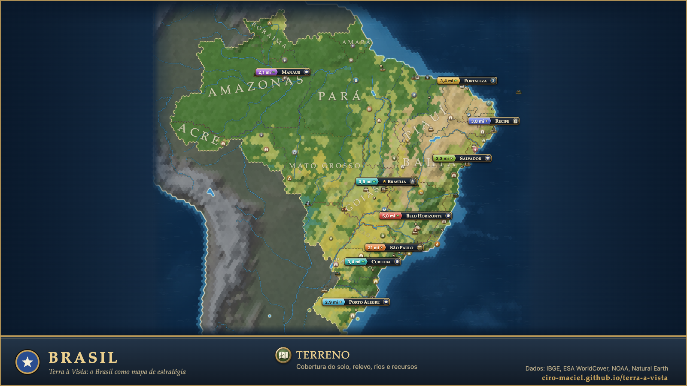

# Terra à Vista

**Brazil drawn as a turn-based strategy map, built from real public data.** Find your city: its banner shows its
people and its GDP, its districts come from what its people actually do for work, and the land under it is the real
relief and land cover. Every number traces back to a public source, listed in the in-app Almanac.

**Live: [ciro-maciel.github.io/terra-a-vista](https://ciro-maciel.github.io/terra-a-vista/?ref=oss-terra-a-vista)** ·
[Leia em português](README.pt-BR.md)



## What is on the map

- **Terrain**: 5,247 land hexes of 50 km, relief from ETOPO1, land cover from ESA WorldCover 2021, rivers, the 27
  states and the neighbours under a light fog.
- **611 cities**: IBGE's population arrangements (municipalities integrated by commuting or continuous urban area)
  and every other municipality of 50,000+ people. Population from the 2022 Census, GDP from the municipal GDP 2023,
  growth from the IBGE estimates 2024–2026, earnings and unemployment from the 2022 Census.
- **Yields**: Gold is GDP; Food, Production, Science and Culture are formal salaried jobs by activity (IBGE CEMPRE 2024).
- **Districts and city types** from location quotients of formal jobs: Macaé is an oil city, Ipatinga a steel town,
  Franca a shoe cluster, São José dos Campos an aerospace city, Sorriso a farm-belt city.
- **1,450 resources**: power plants (ANEEL), offshore oil platforms at sea and oil and gas fields (ANP), mining
  concessions (ANM), and 17 crops and herds (IBGE PAM and PPM 2025).
- **Roads and rail** (Natural Earth), **29 ports** (ANTAQ yearbook 2025), **59 airports** and **40 air routes** (ANAC
  flight statistics 2025, streamed once from a 362 MB file and reduced).
- **13 lenses** from the 2022 Census and land cover: density, median age, ageing, earnings, GDP per person,
  unemployment, literacy, degrees, sewer, water, forest, farmland, built-up.
- **26 wonders**: every Brazilian site on UNESCO's World Heritage List.
- **9 advisors**: dashboards beside the map (Economy with GDP by sector, People, Prosperity, Knowledge, Land,
  Energy and resources, Commerce, Culture and the Explorer), linked to the map both ways.
- **Timeline**, by theme. *People*: the Censuses from 1970 to 2022; banners show each count and the map colours each
  decade's yearly growth on one scale for all. *Land*: MapBiomas Collection 11, every five years from 1985 to 2025,
  the share of each municipality in native vegetation, pasture, agriculture, soy and city, on one scale for all years.
- **Why?** in every city and state panel: population by municipality and Census, GDP by sector and municipality
  (and real change since 2002), growth by the municipalities that gained or lost people, and the city type by the
  activities behind it; and one question per timeline theme ("what happened to the land since 1985?").
- **Citizens** in the city view: work, age, commute and schooling of the people who live there (2022 Census).

## Reading the map honestly

- Yields are names given to real figures. Gold is GDP.
- Job yields and districts count **formal** salaried jobs. About 4 in 10 Brazilian workers are informal, and the
  legend says so.
- Missing data stays missing: `null`, never `0`.
- Selections (cities, districts, resources, wonders) follow rules published inside the data files.
- Port figures are transcribed from ANTAQ's 2025 yearbook (its raw database was offline); each port sits at its
  municipality seat.

## Run it

You need [uv](https://docs.astral.sh/uv/) (or any Python 3.11+). No other dependency, on purpose.

```bash
uv run python -m pipeline serve        # http://127.0.0.1:8765
uv run python -m unittest discover -s tests
uv run python -m pipeline all          # rebuild the data from the publishers (a few hundred MB of downloads)
```

## Where it comes from

Terra à Vista starts from [usaciv](https://karpathy.ai/usaciv/) by Andrej Karpathy (MIT), which draws the United
States the same way. The browser app (hex grid, painted terrain, City View, the map layers) comes from it; the data
pipeline is rewritten for Brazil. His original README is in [docs/upstream/README.md](docs/upstream/README.md).

The look is inspired by turn-based 4X strategy games. Every glyph, icon and texture is original and drawn in code.
This project is not affiliated with or endorsed by any game publisher.

## License

Code: MIT, see [LICENSE](LICENSE) and [NOTICE](NOTICE). The data belongs to its publishers and keeps their terms; the
Almanac lists each one.

Made by [Ciro Cesar Maciel](https://ciromaciel.click/?ref=oss-terra-a-vista).
