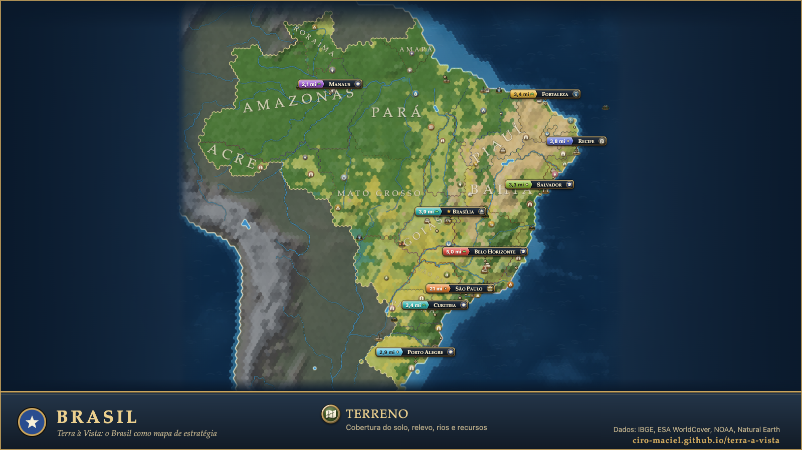

# Terra à Vista

**O Brasil desenhado como mapa de jogo de estratégia por turnos, feito de dados públicos reais.** Procure a sua
cidade: o estandarte mostra a população e o PIB dela, os distritos vêm do que as pessoas de lá fazem para trabalhar, e
o chão é o relevo e a cobertura do solo de verdade. Cada número leva a uma fonte pública, listada no Almanaque.

**No ar: [ciro-maciel.github.io/terra-a-vista](https://ciro-maciel.github.io/terra-a-vista/?ref=oss-terra-a-vista)** ·
[Read in English](README.md)



## O que tem no mapa

- **Terreno**: 5.247 hexágonos de terra de 50 km, relevo do ETOPO1, cobertura do solo do ESA WorldCover 2021, rios, os
  27 estados e os vizinhos sob uma névoa leve.
- **611 cidades**: os arranjos populacionais do IBGE (municípios integrados pelo deslocamento ou pela mancha urbana) e
  todo outro município com 50 mil habitantes ou mais. População do Censo 2022, PIB dos Municípios 2023, crescimento
  pelas estimativas do IBGE de 2024 a 2026, renda e desocupação do Censo 2022.
- **Rendimentos**: Ouro é o PIB; Comida, Produção, Ciência e Cultura são empregos formais por atividade (IBGE, CEMPRE 2024).
- **Distritos e tipos de cidade** pelo quociente locacional dos empregos formais: Macaé é cidade do petróleo, Ipatinga
  do aço, Franca polo calçadista, São José dos Campos cidade aeroespacial, Sorriso cidade do agro.
- **1.450 recursos**: usinas (ANEEL), plataformas de petróleo no mar e campos de petróleo e gás (ANP), concessões de
  lavra (ANM) e 17 lavouras e rebanhos (IBGE, PAM e PPM 2025).
- **Rodovias e ferrovias** (Natural Earth), **29 portos** (Anuário 2025 da ANTAQ), **59 aeroportos** e **40 rotas
  aéreas** (estatísticas da ANAC 2025, lidas em fluxo de um arquivo de 362 MB e resumidas).
- **13 lentes** do Censo 2022 e da cobertura do solo: densidade, idade mediana, envelhecimento, renda do trabalho, PIB
  por habitante, desocupação, alfabetização, ensino superior, esgoto, água, floresta, lavoura, área construída.
- **26 maravilhas**: todos os sítios brasileiros do Patrimônio Mundial da UNESCO.
- **9 conselheiros**: painéis ao lado do mapa (Economia com o PIB por setor, Pessoas, Prosperidade, Conhecimento,
  Terra, Energia e recursos, Comércio, Cultura e o Explorador), ligados ao mapa nos dois sentidos.
- **Linha do tempo**: os Censos de 1970 a 2022; os estandartes mostram a população contada em cada um e o mapa pinta
  o crescimento por ano de cada década, na mesma escala para todas.
- **Por quê?** no painel de cada cidade e estado: a população nos seus municípios e em cada Censo, o PIB nos setores e
  nos municípios (e o crescimento real desde 2002), o crescimento nos municípios que somaram ou perderam gente, e o
  tipo de cidade nas atividades que o explicam.
- **Cidadãos** na tela da cidade: trabalho, idade, deslocamento e instrução de quem mora lá (Censo 2022).

## Como ler o mapa

- Os rendimentos são nomes dados a números reais. Ouro é o PIB.
- Os rendimentos de trabalho e os distritos contam empregos **formais** assalariados. Perto de 4 em 10 trabalhadores
  brasileiros são informais, e a legenda diz isso.
- Dado que falta continua faltando: `null`, nunca `0`.
- O que é escolhido (cidades, distritos, recursos, maravilhas) segue regras publicadas dentro dos arquivos de dados.
- Os números dos portos foram transcritos do Anuário 2025 da ANTAQ (a base bruta estava fora do ar); cada porto fica
  na sede do seu município.

## Rodar

Precisa só do [uv](https://docs.astral.sh/uv/) (ou de qualquer Python 3.11 ou mais novo). Nenhuma outra dependência,
de propósito.

```bash
uv run python -m pipeline serve        # http://127.0.0.1:8765
uv run python -m unittest discover -s tests
uv run python -m pipeline all          # refaz os dados a partir dos publicadores (algumas centenas de MB)
```

## De onde vem

O Terra à Vista parte do [usaciv](https://karpathy.ai/usaciv/), de Andrej Karpathy (MIT), que desenha os Estados
Unidos do mesmo jeito. O aplicativo do navegador (a grade, o terreno pintado, a tela da cidade, as camadas) vem dele; o
pipeline de dados foi reescrito para o Brasil. O README original está em [docs/upstream/README.md](docs/upstream/README.md).

O visual é inspirado em jogos de estratégia 4X por turnos. Todo desenho, ícone e textura é original e feito em código.
Este projeto não tem vínculo com nenhuma editora de jogos.

## Licença

Código: MIT, ver [LICENSE](LICENSE) e [NOTICE](NOTICE). Os dados são dos publicadores e mantêm os termos deles; o
Almanaque lista cada um.

Feito por [Ciro Cesar Maciel](https://ciromaciel.click/?ref=oss-terra-a-vista).
